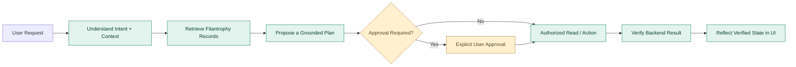
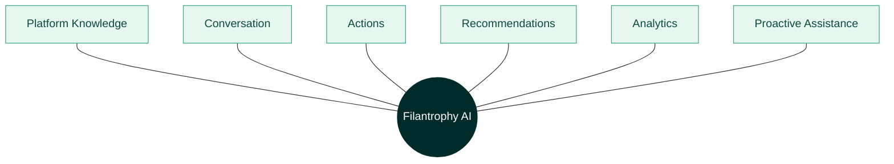
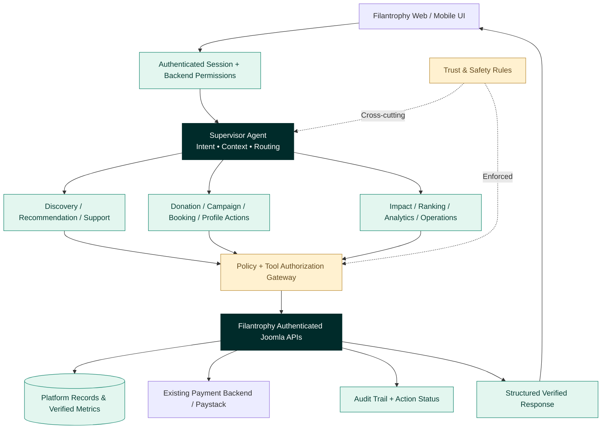
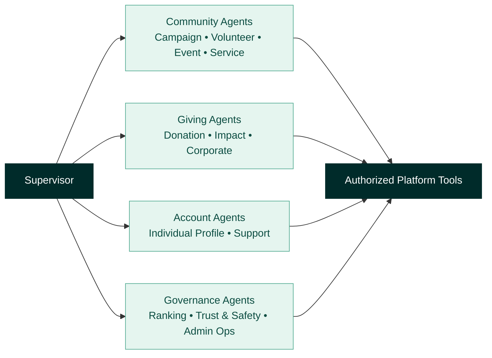
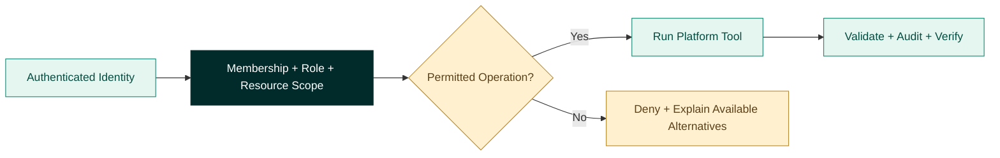
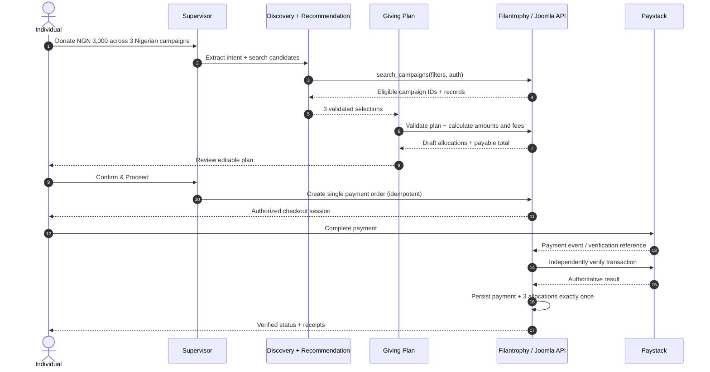
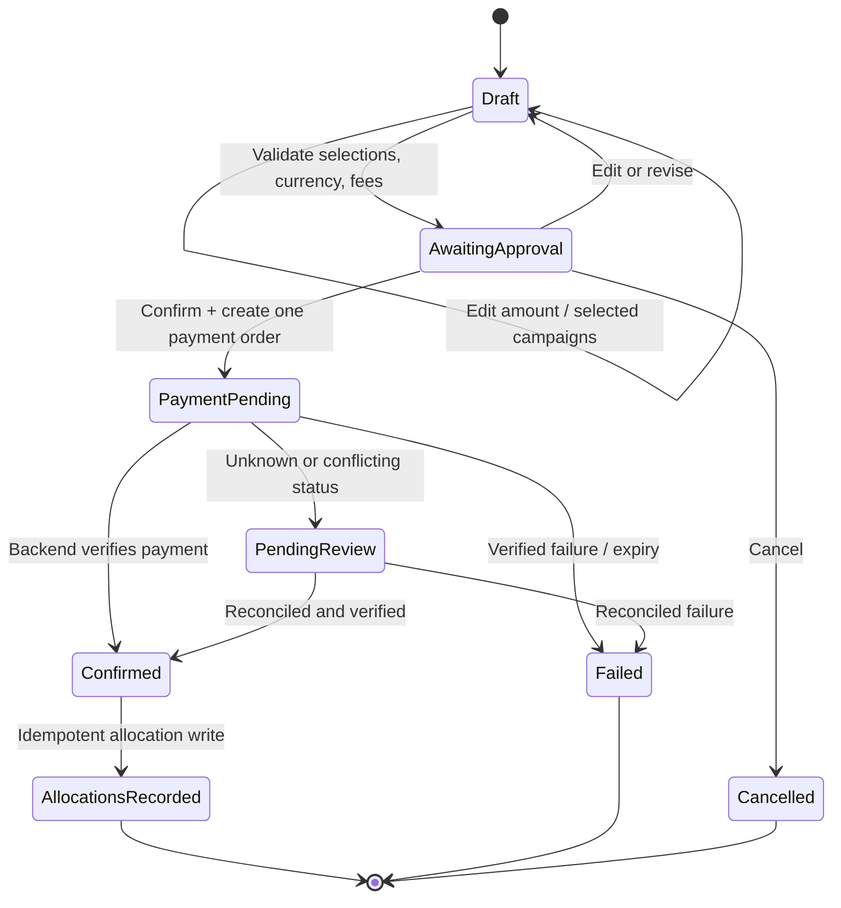

# Filantrophy AI
### Intelligence Architecture, Specialized Agent Ecosystem & Verified Giving Workflow

> **Product architecture / visual specification**  
> **Version:** 1.0 · **Date:** 20 October 2026  
> **Purpose:** Show how Filantrophy AI should understand the platform, serve authenticated roles, take approved actions, and ground claims in verified records.

**Reading key:** **Current workflow** = the seven-stage donation orchestration described for the existing system. **Target capability** = proposed expansion or hardening, not a claim that every agent or safeguard has already been shipped.

---

## 01 · Executive Vision

**One platform. Six intelligence capabilities. Twelve domain-specialized agents. One permission-aware, verifiable experience.**

Filantrophy AI is more than a chatbot. It is an intelligent interaction layer on top of authenticated Filantrophy services: campaigns, donations, volunteer programs, events, services, corporate activity, user profiles, rankings, support and moderation.

Its operating principle is:

**Understand → Retrieve → Reason → Propose → Obtain Approval → Execute Safely → Verify → Explain**

**Platform boundaries**

- Filantrophy-specific questions and actions only; politely redirect unrelated queries.
- Joomla / Filantrophy backend is the system of record, not the language model.
- Role identity and permissions come from authenticated backend session and scopes, never chat claims.
- Any financial, irreversible or high-risk action needs explicit confirmation and verification.
- UI confirmation must reflect a verified backend response, not a predicted success.

---

## 02 · The Six Types of Intelligence

| Intelligence | What Filantrophy AI Will Learn to Do | Required foundation |
|---|---|---|
| **01 · Platform Knowledge** | Explain services, terminology, policies, fees, permissions and workflows. | Versioned product knowledge, policies and reliable help content. |
| **02 · Conversational Understanding** | Follow natural-language instructions, conversational context, corrections and follow-ups. | Intent/slot extraction, session state, ambiguity handling. |
| **03 · Action Intelligence** | Create or change allowed campaigns, giving plans, bookings and applications. | Authenticated write APIs, validations, transaction IDs and audit logs. |
| **04 · Recommendation Intelligence** | Match campaigns, volunteering, events and services to eligibility and user intent. | Real records, grounded filters, clear recommendation rationale. |
| **05 · Analytical Intelligence** | Explain verified donation trends, milestones, engagement, rankings and operational performance. | Aggregated backend metrics, definitions, date ranges and provenance. |
| **06 · Proactive Intelligence** | Surface relevant reminders, anomalies, pending actions and opportunities when authorized. | Explicit opt-in, notification preferences, schedule rules and safeguards. |

**Important:** 'Training' should primarily mean better grounding, intent evaluation, safe tool use, permission checks and regression testing. Model fine-tuning, if needed later, should not replace live data retrieval or deterministic financial logic.

---

## 03 · Agent System Architecture

The **Supervisor Agent** routes to domain agents. A **Trust & Safety policy layer** must guard every sensitive tool call; it is not a bypassable final check. Agents request operations from authenticated APIs and receive structured results.

**Tool response contract (target pattern):** `success`, `record_id`, `status`, `version`, `allowed_next_actions`, `message`, `evidence_reference`, and `request_id` where relevant. Financial operations additionally need server-computed amounts, currency, fees, transaction reference and idempotency key.

**Current vs target:** The current seven-step donation flow uses a supervisor, discovery, recommendation, giving-plan, approval and checkout sequence. The 12-domain catalog below represents the broader specialized-agent vision; the diagram does not imply all 12 are deployed today.

---

## 04 · Twelve Specialized Agents

### Discovery, Giving & Participation

| Specialized Agent | Capabilities | Example intent |
|---|---|---|
| **Campaign Agent** | Discover real campaigns, compare progress, draft campaign content, recommend improvements. | “Find verified healthcare campaigns in Nigeria.” |
| **Donation Agent** | Draft giving plans, edit amounts, split allocations, check payment status. | “Change my giving plan to ₦10,000.” |
| **Impact Agent** | Explain verified achievements, milestones, donation outcomes and receipt evidence. | “What did my last donation achieve?” |
| **Volunteer Agent** | Match opportunities, assist with applications, retrieve approved attendance and verified hours. | “Show my verified volunteer hours.” |
| **Event Agent** | Find events, show schedules and help register where allowed. | “Find upcoming events I can attend.” |
| **Service Provider Agent** | Search listings, compare eligible services and availability, prepare bookings. | “Help me find a wellness consultation.” |

### Profiles, Ranking, Support & Operations

| Specialized Agent | Capabilities | Example intent |
|---|---|---|
| **Corporate Agent** | CSR budgeting, employee volunteering and grounded corporate impact summaries. | “Summarize this quarter’s CSR giving.” |
| **Individual Profile Agent** | Profile settings, following, achievements and personal giving summaries. | “Show the campaigns I follow.” |
| **Ranking Agent** | Explain rankings with visible methodology and period, across eligible entities. | “Why is this provider ranked higher?” |
| **Support Agent** | Explain policy and workflows; triage payment issues with status-aware guidance. | “My payment is pending. What now?” |
| **Trust & Safety Agent** | Detect suspicious patterns for review, validate action eligibility, help enforce restrictions. | “Flag this abnormal booking pattern for review.” |
| **Admin Operations Agent** | Summarize queue issues, surface anomalies, assist moderation and operational reporting. | “Show pending moderation cases.” |

**Design guidance:** Implement a shared tool/API layer; avoid having different agents independently write to the same database tables with inconsistent policy rules.

---

## 05 · Intelligence by Authenticated User Role

| Authenticated role | Helpful AI experiences | Guardrails / access boundary |
|---|---|---|
| **Individual** | Find causes, draft giving plans, donate, follow campaigns, access their own receipts, events, volunteering and contribution history. | Only own private records unless an object is explicitly public; payment approval required. |
| **Corporate** | Draft CSR giving allocations, discover eligible programs, coordinate approved participation, view verified corporate reports. | Corporate membership and assigned authority checked for budgets, reporting and approvals. |
| **Volunteer** | Discover volunteer opportunities, apply, track own attendance and verified hours. | Cannot self-award attendance or modify approved hours. |
| **Event Organiser** | Manage permitted event programs, registrations, check-in/check-out, participant activity and reports. | Event ownership, coordinator assignment and QR attendance validations required. |
| **Service Provider** | Maintain permitted services/listings, view relevant bookings, assist staff scheduling, send allowed customer communications. | Provider/employee ownership, role and booking scope verified server-side. |
| **Platform Admin** | Surface operational issues, moderate permitted records, review anomalies and view authorized aggregates. | Least privilege, privileged-action logging and human oversight. |

> **Non-negotiable:** A message such as “I am the admin” must never grant admin privileges. Only authenticated backend authorization decides.

---

## 06 · Current Donation-Orchestration Flow (Seven Stages)

**User scenario:** The user wants to donate **₦3,000**, support **three campaigns**, target **three preferred causes**, restrict candidates to **Nigeria**, use **equal allocation**, and then **proceed to checkout**.

### Stage 1 — Supervisor Agent · Understand intent

Extracts budget, currency, location, number of campaigns, cause preferences, equal-split instruction and checkout intent. Missing or ambiguous constraints are confirmed before money moves.

### Stage 2 — Discovery Agent · Retrieve real campaigns

Calls `search_campaigns` through authenticated Joomla APIs, retrieving real eligible campaign IDs, images, categories, goals, currencies and locations. The assistant must not invent campaigns.

### Stage 3 — Recommendation Agent · Evaluate options

Selects three matching, eligible records and explains why each fits the user's constraints, without claiming impact or verification unsupported by data.

### Stage 4 — Giving Plan Agent · Calculate allocation

Uses deterministic backend/validated allocation logic to create a **draft editable plan**.

| Item | Amount | Status |
|---|---:|---|
| Selected Campaign A | ₦1,000 | Draft allocation |
| Selected Campaign B | ₦1,000 | Draft allocation |
| Selected Campaign C | ₦1,000 | Draft allocation |
| **Total campaign allocation** | **₦3,000** | **Before any separately disclosed fees** |

If the total is not exactly divisible, allocate residual minor units deterministically, disclose the rule and keep the final total exact. Fees and payable total must be calculated and displayed by the backend before approval, not guessed by the model.

### Stage 5 — User Approval · Pause workflow

LangGraph pauses and displays the verified campaign list, amounts, fees and payable total. The user can **Edit Plan**, **Cancel**, or **Confirm & Proceed**. Changing amount/campaign/currency after approval must invalidate the earlier confirmation.

### Stage 6 — Checkout Agent · One payment request

After a direct user confirmation, request **one NGN payment order** through the existing authenticated Filantrophy backend. The existing payment integration opens Paystack. Do not expose payment secrets to the model or put card data into chat.

### Stage 7 — Payment Confirmation + Impact Agent · Verify result

Filantrophy / Joomla independently verifies the Paystack transaction, then records all three allocations with payment references and confirmed statuses. Only after backend verification should the assistant show confirmed donations, receipts or resulting impact records.

---

## 07 · Payment & Plan State Management

Financial state must be deterministic and backend-owned. A conversational acknowledgment is not a payment settlement.

**Critical invariant:** `sum(allocations) = planned donation amount`. The **final payable total** can differ if a separately disclosed platform/payment fee applies. Retrying a callback or refreshing a screen must not duplicate charges or allocations.

---

## 08 · Natural-Language UX: Intent Must Change the Real UI

| User request | AI interpretation | Expected verified UI behavior |
|---|---|---|
| **“Update the donation amount to ₦10,000.”** | Edit the active, unpaid giving-plan draft. | Recalculate allocations and fees, persist/validate revision, update plan display, require renewed approval. |
| **“Donate ₦20,000 to healthcare.”** | Discover eligible healthcare campaigns and prepare an allocation plan. | Show only actual matched campaigns, proposed split, totals and approval controls; no automatic payment. |
| **“Show my verified volunteer hours.”** | Read the authenticated volunteer's approved attendance records. | Render hours and dates from verified backend records; no invented hours. |
| **“Why is this provider ranked higher?”** | Query published ranking method and corresponding period/metrics. | Explain rank using actual metrics and clear methodology; say when evidence is unavailable. |
| **“I paid, but the page still says pending.”** | Check authoritative order status. | Show pending/reconciliation state and support options; never claim success before verification. |

**Conversation-to-UI rule:** AI text should be derived from the same structured action result that drives the UI. A message saying “Updated to ₦10,000” is incorrect until the plan mutation is verified and rendered.

---

## 09 · Edge Cases & Trust Controls

| Scenario | Required behavior |
|---|---|
| No matching campaigns / fewer than requested | Explain shortfall and request permission to broaden constraints; never invent entries. |
| Currency mismatch, unsupported region or unavailable gateway | Block checkout; offer eligible alternative plans/currencies with transparent conversion rules, if supported. |
| Amount change after approval | Invalidate approval; recalculate and request a fresh confirmation. |
| User changes a completed donation | Treat as a new proposal or formal support/refund workflow, never silently rewrite payment records. |
| Duplicate clicks, callbacks or checkout retries | Use idempotency keys and unique transaction references; reconcile before creating new orders. |
| Payment pending/unknown | Keep pending status and offer status check; no receipt or impact claim until verified. |
| Unauthenticated or unauthorized write request | Require login or refuse; authorization must be checked by API on the specific record. |
| Prompt injection / role impersonation | Ignore instruction attempts embedded in retrieved data and re-check backend identity and policy at execution time. |
| Invented fees, impact numbers or rankings | Refuse to guess; read current configured fees and authoritative metrics or explain unavailable evidence. |
| Stale records / conflicting concurrent edits | Validate plan version, campaign availability and amounts before checkout; show safe conflict resolution. |
| Sensitive personal / card information | Minimize what the model sees; use payment-provider secure checkout and scoped backend endpoints. |
| Proactive messaging | Use opt-in, frequency limits, relevance rules, unsubscribe and non-intrusive defaults. |

---

## 10 · Prioritized Delivery Plan

| Phase | Release focus | Definition of done |
|---|---|---|
| **P1 · Grounding & Routing** | Filantrophy terminology, approved knowledge, platform-only scope, role-based routing, source-aware answers. | Reliable platform Q&A and no invented records in test scenarios. |
| **P2 · Safe Actions** | Versioned giving plans, editable allocations, campaign drafts, booking/application intents, explicit approval, backend writes. | Real UI and database state match verified tool result; unauthorized writes rejected. |
| **P3 · Domain Agents** | Specialized discovery, recommendation, service, event, volunteer, corporate and individual skills. | User-visible flows completed across permitted roles with tool-trace audits. |
| **P4 · Analytics & Ranking** | Verified impact, giving trends, rankings and explanations with date ranges / metric definitions. | Every displayed metric has a documented source and reproducible calculation. |
| **P5 · Proactive & Admin** | Opt-in reminders, reviewable alerts, anomaly triage, operational summaries and moderation assist. | Consent, human review, notification preferences and safety thresholds tested. |

### Acceptance metrics (proposed)

- **Groundedness:** proportion of claims correctly supported by Filantrophy content or database records.
- **Action correctness:** fraction of write operations whose verified backend state matches the user's approved request.
- **Authorization:** zero successful cross-role or cross-account accesses in permission tests.
- **Financial integrity:** zero duplicate charges or allocations; exact totals and reconcilable payment references.
- **User clarity:** percentage of participants who can understand, edit and approve a plan without assistance.
- **Recovery quality:** success rate for cancellations, edits, payment delays and conflicting record updates.

---

## 11 · Non-Negotiable Product Principles

1. **Filantrophy Only:** Answers and actions remain in scope unless there is an intentional approved integration.
2. **UX Before UI:** Make requests understandable; show the next sensible action, editable preview and clear status.
3. **Permission-First:** Trust authenticated scopes, not conversational role claims.
4. **Plan Before Payment:** Draft, review and approve before initiating payment.
5. **Deterministic Money Logic:** Model suggestions are not accounting calculations.
6. **Verified Truth:** Confirm records, financial status, milestones and rankings through authoritative APIs.
7. **Safe Failure:** Show actionable errors, never false success states.
8. **Consistent Design System:** Shared components and states across all Filantrophy portals.
9. **Explainability:** Recommendations and rankings should explain their sources and rules.
10. **Auditability:** Track significant actions, approvals, revisions and transaction references.

> **Product statement:** **Filantrophy AI should not merely answer what users ask. It should help them complete legitimate tasks safely, with the right permissions, understandable approvals and verified outcomes.**

---

*This document combines the user's described seven-stage current workflow with a forward-looking agent architecture and proposed controls. It is a product specification and does not independently certify any production deployment or payment integration.*
